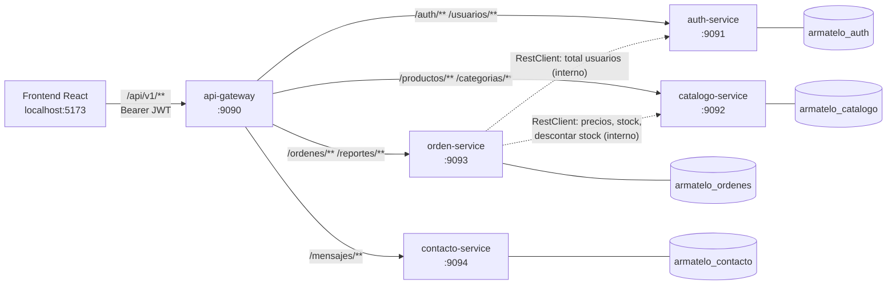
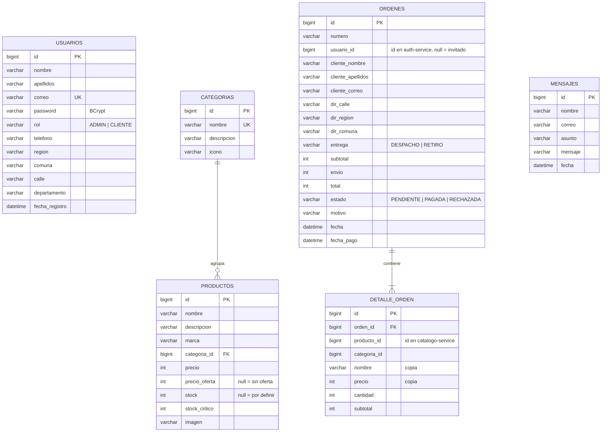

# Armatelo — Backend en microservicios

Backend de la tienda **Armatelo** (componentes de PC) para el frontend React `arm-telo-app-main`.
Está dividido en **4 microservicios + 1 API Gateway**, cada uno con su propia base de datos MySQL.



| Servicio | Puerto | Base de datos | Responsabilidad | Páginas del frontend |
|---|---|---|---|---|
| `api-gateway` | **9090** | — | Punto de entrada único, ruteo y CORS | (todas) |
| `auth-service` | 9091 | `armatelo_auth` | Login, registro, emisión del JWT, perfil, usuarios | Login, Registro, Perfil, Admin › Usuarios, Admin › Perfil |
| `catalogo-service` | 9092 | `armatelo_catalogo` | Productos, categorías, ofertas, stock | Inicio, Productos, Detalle, Categorías, Ofertas, Admin › Productos, Críticos, Categorías |
| `orden-service` | 9093 | `armatelo_ordenes` | Checkout, pago simulado, boletas, historial, reportes | Carrito › Checkout, Compra exitosa/error, Perfil (compras), Admin › Órdenes, Boleta, Historial, Reportes, Dashboard |
| `contacto-service` | 9094 | `armatelo_contacto` | Mensajes de contacto | Contacto |

## Tecnologías

| | |
|---|---|
| Java 21 · Spring Boot **4.0.9** | Web MVC, Data JPA, Validation, Security |
| Spring Cloud **2025.1.4** | Spring Cloud Gateway (WebFlux) |
| MySQL 8 + **Liquibase** | Una base por servicio; tablas y datos iniciales versionados |
| **JWT** | `auth-service` lo emite (jjwt, HS256); todos lo validan como **OAuth2 Resource Server** |
| **RestClient** | Comunicación entre microservicios |
| **Lombok** | `@Getter/@Setter` en entidades, `@RequiredArgsConstructor` en servicios y controladores |
| Swagger (springdoc 3) | Un Swagger por microservicio |
| Docker / Docker Compose | `Dockerfile` multi-etapa por servicio (compila dentro de Docker) |
| JUnit 5 + Mockito | Pruebas unitarias por servicio |

---

## 1. Ejecutar

### Opción A — Todo con Docker (recomendada)
Requiere solo **Docker Desktop** (no necesita Java, Maven ni MySQL instalados):
```bash
docker compose up -d --build
```
Levanta MySQL, los 4 microservicios y el gateway. Liquibase crea las bases, tablas y datos iniciales.
La primera vez tarda varios minutos porque Maven descarga dependencias dentro de Docker.

### Para detener el backend en docker
```bash
docker compose down -v
```
> Si ya tienes un MySQL local usando el puerto 3306, deténlo o cambia el puerto publicado en `docker-compose.yml`.

### Opción B — Cada servicio por separado (desarrollo)
Requiere JDK 21+ y un MySQL en `localhost:3306` (usuario `root` / clave `root`). Por ejemplo, solo la base con Docker: `docker compose up -d mysql`.

Abrir una terminal por servicio:
```bash
cd auth-service     && mvnw.cmd spring-boot:run
cd catalogo-service && mvnw.cmd spring-boot:run
cd orden-service    && mvnw.cmd spring-boot:run
cd contacto-service && mvnw.cmd spring-boot:run
cd api-gateway      && mvnw.cmd spring-boot:run
```
(En Linux/macOS usar `./mvnw`.)

### Pruebas
```bash
cd <servicio> && mvnw.cmd test
```

### URLs
| | URL |
|---|---|
| API para el frontend (gateway) | `http://localhost:9090/api/v1` |
| Swagger auth-service | http://localhost:9091/swagger-ui.html |
| Swagger catalogo-service | http://localhost:9092/swagger-ui.html |
| Swagger orden-service | http://localhost:9093/swagger-ui.html |
| Swagger contacto-service | http://localhost:9094/swagger-ui.html |

Para probar rutas protegidas en Swagger: hacer login en auth-service, copiar el `token` y pegarlo en **Authorize** del Swagger del servicio que se quiera probar (el mismo token sirve en todos).

---

## 2. Configuración (`application.properties`)

Cada servicio tiene su `src/main/resources/application.properties`. Los valores `${VARIABLE:valor}` se pueden sobrescribir con variables de entorno:

| Variable | Por defecto | Usada en |
|---|---|---|
| `PORT` | 9090 … 9094 | todos |
| `DB_HOST` / `DB_PORT` | `localhost` / `3306` | servicios con base de datos |
| `DB_USER` / `DB_PASSWORD` | `root` / `root` | servicios con base de datos |
| `JWT_SECRET` | clave de desarrollo | **misma en todos** los servicios |
| `JWT_EXPIRACION_MINUTOS` | `480` | auth-service |
| `CLAVE_INTERNA` | clave de desarrollo | auth, catálogo y órdenes |
| `CATALOGO_URL` / `AUTH_URL` | `http://localhost:9092` / `:9091` | orden-service y gateway |
| `ORDEN_URL` / `CONTACTO_URL` | `http://localhost:9093` / `:9094` | gateway |
| `CORS_ORIGENES` | `http://localhost:5173,http://localhost:4173` | gateway |

Las tablas **no** las crea Hibernate (`spring.jpa.hibernate.ddl-auto=none`): las crea **Liquibase** con `src/main/resources/db/changelog/db.changelog.sql`.

---

## 3. Cuentas de prueba y datos iniciales (Liquibase)

| Rol | Correo | Contraseña |
|---|---|---|
| Administrador | `admin@armatelo.cl` | `Admin1234` |
| Cliente | `cliente@armatelo.cl` | `Cliente1234` |

Además: las 8 categorías del frontend (mismos ids que `src/data/seed.js`) y 9 productos de ejemplo.

---

## 4. Seguridad

| Tipo de usuario | Permisos |
|---|---|
| **admin** | Acceso total. |
| **cliente** | Solo la tienda: catálogo, checkout, su perfil y sus compras. |
| *invitado* (sin token) | Navega el catálogo y puede comprar sin cuenta. |

**Cómo funciona el JWT**
1. El frontend hace login en `POST /api/v1/auth/login` (gateway → auth-service).
2. auth-service verifica la contraseña (**BCrypt**) y firma un JWT **HS256** con `sub` = correo, `id` y `rol`.
3. El frontend envía `Authorization: Bearer <token>` en cada petición.
4. **Cada microservicio** valida el token como *OAuth2 Resource Server* (firma y expiración) y convierte el claim `rol` en `ROLE_ADMIN` / `ROLE_CLIENTE`. Los permisos se aplican en el `SecurityConfig` de cada servicio.

Como cada servicio valida el token por sí mismo, acceder directamente a un servicio (sin pasar por el gateway) no salta la seguridad.

**Comunicación interna**: los endpoints `/internal/**` (descontar stock, contar usuarios) no se publican en el gateway y exigen el encabezado `X-Clave-Interna`.

Respuestas de seguridad: sin token o token inválido → **401**; rol insuficiente → **403**.
Si el frontend envía un token expirado incluso a una ruta pública, la respuesta es 401: el frontend debe borrar el token y volver a pedir login.

---

## 5. Modelo de datos

Cada servicio es dueño de sus tablas. Entre servicios **no hay claves foráneas**: se guardan ids (`usuario_id`, `producto_id`, `categoria_id`) y una **copia** de los datos necesarios (nombre y precio en la boleta).



`usuarios` → armatelo_auth · `categorias`, `productos` → armatelo_catalogo · `ordenes`, `detalle_orden` → armatelo_ordenes · `mensajes` → armatelo_contacto.

---

## 6. Reglas de negocio (iguales al frontend)

- **Stock sin definir** (`null`) cuenta como 0. **Oferta** solo si `0 < precioOferta < precio`; el **precio final** usa la oferta.
- **Stock crítico**: `stock <= stockCritico`.
- **Checkout** (orden-service): consulta precio y stock de cada producto a catalogo-service, recalcula totales (no confía en el navegador), suma el envío (`despacho` $3.990, `retiro` $0) y exige dirección solo para despacho. Queda `pendiente`.
- **Número de boleta**: `yyyyMMdd` + id (ej. `2026111607`); **código**: `ORDER00007`.
- **Pago simulado**: `rechazado` → orden `rechazada` ("El banco rechazó la transacción."). `aprobado` → catalogo-service revalida y **descuenta el stock en una sola operación (todo o nada)**; si no alcanza, la orden queda `rechazada` con el motivo. Una orden pagada no se vuelve a pagar.
- No se puede eliminar una categoría con productos ni la propia cuenta.

---

## 7. Endpoints (a través del gateway `http://localhost:9090/api/v1`)

Leyenda: 🌐 público · 🔑 autenticado · 🛡️ solo admin

| Método | Ruta | Acceso | Servicio | Descripción |
|---|---|---|---|---|
| POST | `/auth/login` | 🌐 | auth | `{ token, tipo, expiraEnMinutos, usuario }` |
| POST | `/auth/registro` | 🌐 | auth | Crea cuenta **cliente** y devuelve token |
| GET | `/auth/me` | 🔑 | auth | Usuario de la sesión |
| GET · PUT | `/usuarios/me` | 🔑 | auth | Ver / editar mi perfil |
| GET · POST | `/usuarios` | 🛡️ | auth | Listar / crear (rol `admin` o `cliente`) |
| GET · PUT · DELETE | `/usuarios/{id}` | 🛡️ | auth | Obtener / editar / eliminar |
| GET | `/productos?texto=&categoriaId=&min=&max=&orden=` | 🌐 | catálogo | Catálogo con filtros |
| GET | `/productos/ofertas` | 🌐 | catálogo | En oferta |
| GET | `/productos/{id}` | 🌐 | catálogo | Detalle |
| GET | `/productos/criticos` | 🛡️ | catálogo | Stock crítico |
| POST · PUT `/{id}` · DELETE `/{id}` | `/productos` | 🛡️ | catálogo | CRUD |
| GET | `/categorias`, `/categorias/{id}` | 🌐 | catálogo | Listar / obtener |
| POST · PUT `/{id}` · DELETE `/{id}` | `/categorias` | 🛡️ | catálogo | CRUD |
| POST | `/ordenes` | 🌐 | órdenes | Checkout (con token queda asociada al usuario) |
| POST | `/ordenes/{id}/pago` | 🌐 | órdenes | `{ "resultado": "aprobado" \| "rechazado" }` |
| GET | `/ordenes?estado=` | 🛡️ | órdenes | Admin › Órdenes |
| GET | `/ordenes?usuarioId=&correo=` | 🛡️ | órdenes | Admin › Usuarios › Historial |
| GET | `/ordenes/mias` | 🔑 | órdenes | Mis compras |
| GET | `/ordenes/{id}` | 🛡️ / 🔑 dueño / 🌐 `?correo=` | órdenes | Boleta |
| GET | `/reportes/resumen` | 🛡️ | órdenes | Reportes y Dashboard |
| GET | `/reportes/ordenes.csv` | 🛡️ | órdenes | Descarga CSV |
| POST | `/mensajes` | 🌐 | contacto | Formulario de contacto |
| GET · DELETE `/{id}` | `/mensajes` | 🛡️ | contacto | Leer / eliminar |

Formato de error común:
```json
{ "status": 400, "error": "Bad Request", "mensaje": "Revisa los datos ingresados.",
  "ruta": "/api/v1/productos", "campos": { "precio": "El precio es obligatorio." }, "fecha": "2026-11-16T10:15:00" }
```

Ejemplo de flujo completo:
```bash
# Login
curl -X POST http://localhost:9090/api/v1/auth/login -H "Content-Type: application/json" \
  -d '{"correo":"admin@armatelo.cl","password":"Admin1234"}'

# Checkout como invitado y pago
curl -X POST http://localhost:9090/api/v1/ordenes -H "Content-Type: application/json" -d '{
  "cliente": {"nombre":"Ana","apellidos":"Pérez","correo":"ana@correo.cl"},
  "direccion": {"calle":"Av. Siempre Viva 123","region":"Región Metropolitana","comuna":"Santiago"},
  "entrega": "despacho", "items": [{"productoId":1,"cantidad":2}] }'
curl -X POST http://localhost:9090/api/v1/ordenes/1/pago -H "Content-Type: application/json" -d '{"resultado":"aprobado"}'

# Reporte (con el token del admin)
curl http://localhost:9090/api/v1/reportes/resumen -H "Authorization: Bearer <TOKEN>"
```

---

## 8. Integración con el frontend

El frontend llama **solo al gateway**; no necesita conocer los microservicios.

```js
// src/services/api.js
import axios from 'axios';

export const api = axios.create({ baseURL: 'http://localhost:9090/api/v1' });

api.interceptors.request.use((config) => {
  const token = localStorage.getItem('armatelo:token');
  if (token) config.headers.Authorization = `Bearer ${token}`;
  return config;
});
```

| Frontend actual (`db.js` / contextos) | API |
|---|---|
| `iniciarSesion(correo, password)` | `api.post('/auth/login', { correo, password })` → guardar `token` |
| `registrar(datos)` | `api.post('/auth/registro', datos)` |
| `actualizarPerfil(cambios)` | `api.put('/usuarios/me', cambios)` |
| `listar('productos')` / `obtener('productos', id)` | `api.get('/productos')` / `api.get('/productos/' + id)` |
| `crear` / `actualizar` / `eliminar('productos', …)` | `api.post` / `api.put` / `api.delete` en `/productos` |
| `listar('categorias')` | `api.get('/categorias')` |
| `listar('usuarios')` | `api.get('/usuarios')` |
| `ordenesDeUsuario(ordenes, usuario)` (AdminHistorial) | `api.get('/ordenes', { params: { usuarioId, correo } })` |
| `crearOrden(...)` | `api.post('/ordenes', { cliente, direccion, entrega, items: [{ productoId, cantidad }] })` |
| `pagarOrden(id, resultado)` | `api.post('/ordenes/' + id + '/pago', { resultado })` |
| `listar('ordenes')` (admin) | `api.get('/ordenes')` |
| Compras en Perfil | `api.get('/ordenes/mias')` |
| `calcularReporte(...)` | `api.get('/reportes/resumen')` |
| Formulario de contacto | `api.post('/mensajes', datos)` |

Los nombres de los campos JSON son los mismos del frontend (`nombre`, `precioOferta`, `stockCritico`, `categoriaId`, `cliente`, `direccion`, `items`, `estado`…). Roles, estados y entrega van en minúsculas (`admin`, `pagada`, `despacho`). Un campo vacío (`''`) de `precioOferta` o `stock` se envía como `null`.
